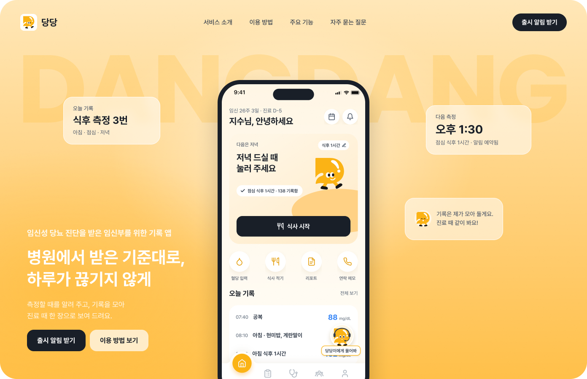
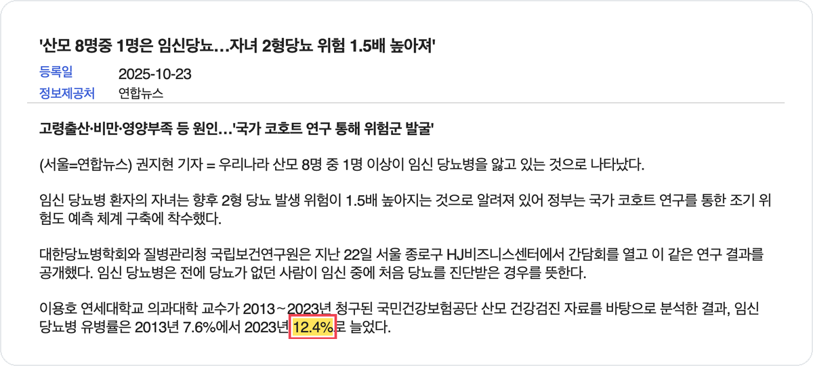
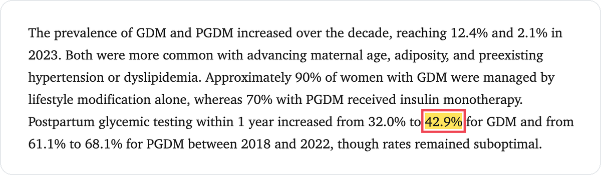
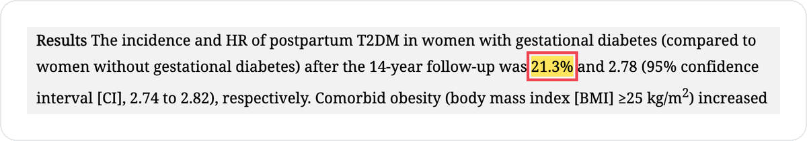
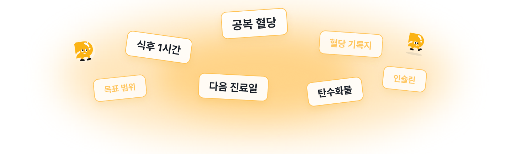
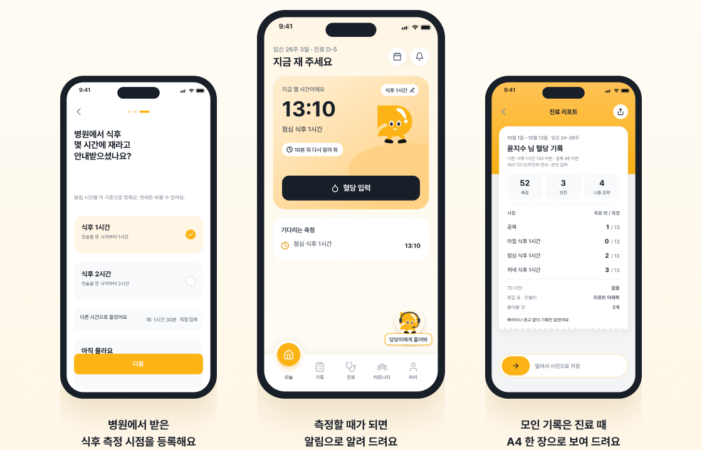
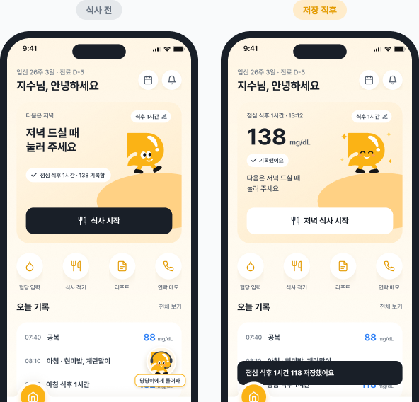
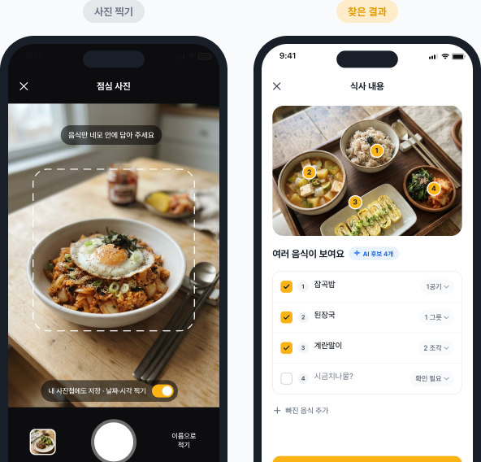
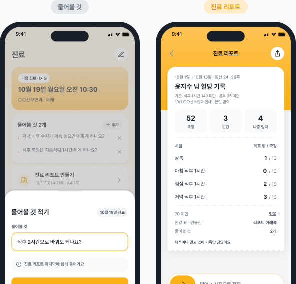
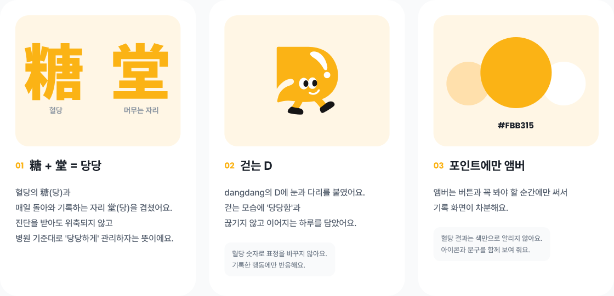

 

# 당당

임신성 당뇨 진단을 받은 임신부를 위한 기록 앱

[**dang-dang.site 바로가기 →**](https://dang-dang.site)

 
 

WHY

## 진료실 밖의 하루는 산모 혼자의 몫이었어요

*"식후 1시간에 재세요."* 
진료실에서 들은 이 한마디를 지키는 일은 
집으로 돌아온 산모가 혼자 해내야 했어요.

 

### 산모 8명 중 1명

임신성 당뇨 유병률은 10년 사이 
**7.6%에서 12.4%로** 늘었어요.

연합뉴스, 2025.10.23 · <a href="https://m.bokjiro.go.kr/ssis-tem/cms/mob/news/news/1308835_1122.html">원문 보기</a>

 
 

### 출산 뒤엔 절반도 검사받지 않아요

산후 1년 안에 혈당 검사를 받은 산모는 
**42.9%** 에 그쳐요.

Moon JH 외, <i>Diabetes Metab J</i> 2026 · <a href="https://pmc.ncbi.nlm.nih.gov/articles/PMC12996964/">원문 보기</a>

 
 

### 그런데 위험은 계속돼요

임신성 당뇨를 겪은 산모는 14년 동안 
**21.3%** 가 제2형 당뇨로 이어졌어요.

국내 전국 코호트, <i>Endocrinol Metab</i> · <a href="https://e-enm.org/journal/view.php?number=2270">원문 보기</a>

 
 

BACKGROUND

## 병원과 병원 사이, 그 빈칸을 채워요

병원은 측정 시점과 목표 범위를 알려 줘요. 
그런데 끼니마다 시간을 맞춰 재고, 숫자를 적고, 
다음 진료 때 보여 주는 일은 혼자 해내야 해요.

**당당은 병원에서 받은 기준을 하루 일정으로 바꿔** 
**측정 · 기록 · 진료 준비가 끊기지 않게 도와요.**

 
 

HOW IT WORKS

## 세 단계면 오늘부터 시작해요

 
 

FEATURES

## 필요한 순간에 필요한 것만 보여 줘요

 

### 지금 할 일 하나만, 오늘 화면 맨 위에

식사 전이면 '식사 시작', 측정할 때면 '혈당 입력'. 
시간에 따라 첫 카드가 바뀌어서 
무엇을 할지 고민하지 않아도 돼요.

 
 

### 사진 한 장이면 먹은 음식 후보를 찾아 줘요

한식 150종을 배운 AI가 음식 후보를 보여 주고, 
맞는지 직접 확인한 뒤에 저장돼요. 
사진 없이 이름으로 적어도 괜찮아요.

 
 

### 진료 날엔 기록과 물어볼 것을 한 장에

혈당 · 식사 기록을 A4 한 장 리포트로 정리하고, 
사진으로 저장해 진료 때 바로 보여 줘요. 
물어볼 것도 미리 적어 둘 수 있어요.

 
 

TRUST

## 믿고 쓸 수 있도록 지키는 세 가지

 

**기준은 담당 의료진이 정해요** 
당당은 목표 범위나 측정 시점을 정하지 않아요. 
병원에서 받은 기준을 그대로 따라요.

 

**진단 · 치료를 하지 않아요** 
수치를 판단하지 않고, 진료 때 물어볼 말로 정리해요. 
위험한 증상엔 AI 대신 정해진 안내를 바로 보여 줘요.

 

**건강정보는 동의한 만큼만** 
건강 기록은 따로 동의한 뒤에만 다루고, 
AI 사진 기능도 따로 동의받아요.

 
 

BRAND STORY

## 당당이라는 이름에서 모든 디자인이 시작됐어요

 
 

TECH STACK

## 이렇게 만들었어요

 

**Frontend**

Zustand · TanStack Query · PWA (웹 푸시)

 
 

**Backend**

Spring Security · JWT · JPA · Flyway · Swagger

 
 

**AI**

ONNX Runtime (한식 150종 분류) · OpenAI API (당당이 챗봇 · 물어볼 것 정리)

 
 

**Infra**

KT Cloud · Let's Encrypt · Docker Hub

 
 

**Collaboration**

 
 

공공데이터포털 식품영양성분 DB · 카카오 로그인

 
 

REPOSITORIES

## 저장소

| 저장소 | 하는 일 |
|:---|:---|
| [**dangdang-fe**](https://github.com/dangdang-2026/dangdang-fe) | 산모가 쓰는 화면 (PWA) |
| [**dangdang-be**](https://github.com/dangdang-2026/dangdang-be) | 기록 · 알림 · 리포트 API |
| [**dangdang-ai**](https://github.com/dangdang-2026/dangdang-ai) | 음식 사진 분류 · 당당이 챗봇 |

 
 

TEAM

## 팀 당당

|  |  |
|:---:|:---:|
| **김승민** | **임다현** |
| Frontend · Backend | PM · AI · Infra |
| [@seungminng123](https://github.com/seungminng123) | [@dahyun0423](https://github.com/dahyun0423) |

 
 

### 혼자 챙기던 관리를, 이제 당당하게.

[**dang-dang.site →**](https://dang-dang.site)

 

당당은 진단 · 치료를 대신하지 않아요. 모든 관리 기준은 담당 의료진의 안내를 따라요.

